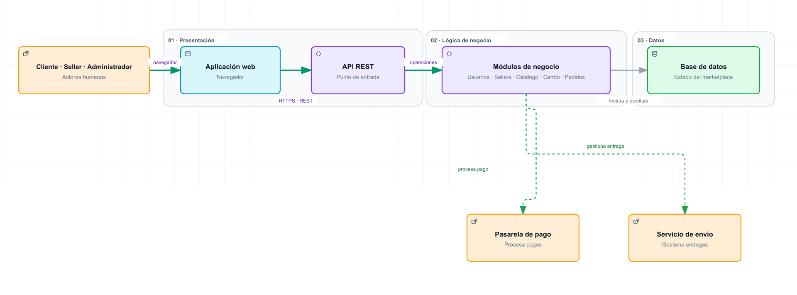

# Arquitectura inicial del sistema

Antecedente de la Guía 02; la propuesta detallada y sus integraciones se muestran en el [modelo C4](../04-modelo-c4/Nivel1-DiagramadeContextodelSistema.md).

| Capa | Responsabilidad |
|---|---|
| Presentación | Interacción web y recepción de solicitudes REST. |
| Lógica de negocio | Usuarios, sellers, productos, carrito y coordinación de pedidos. |
| Datos | Persistencia de información y transacciones. |

La vista inicial resume integraciones. [Componentes arquitectónicos](componentes-arquitectonicos.md) detalla Pagos, Envíos y Notificaciones.
