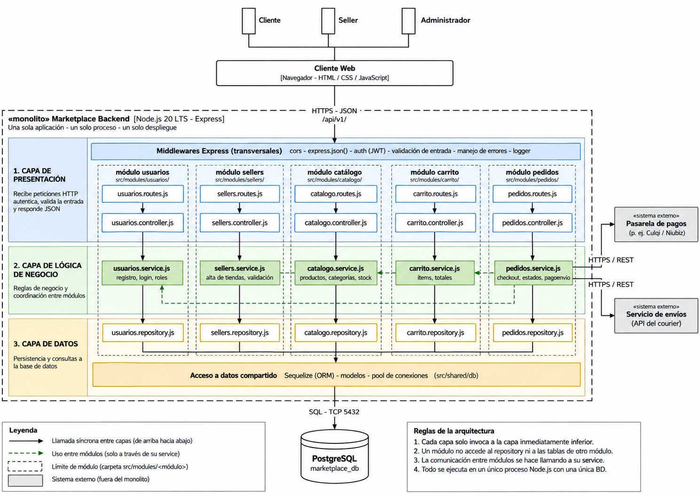

# Estilo arquitectónico

**Monolito modular organizado en capas.** Los módulos del backend comparten una unidad de despliegue y colaboran mediante contratos.

| Decisión | Aplicación |
|---|---|
| Cliente-servidor | Web separada de la API mediante REST. |
| Capas | Presentación, lógica de negocio y acceso a datos. |
| Modularidad | Usuarios, Sellers, Catálogo, Carrito y Pedidos; el detalle de componentes incorpora Pagos, Envíos y Notificaciones. |
| Evolución | Replicar el backend completo cuando las mediciones lo justifiquen; no se escalan módulos de forma independiente. |

Se elige por DA01 y DA06: mantiene un despliegue sencillo y permite delimitar responsabilidades. [ADR](../01-analisis-de-sistema/07-decisiones-arquitectonicas.md) registra caché, seguridad, integraciones y REST.
