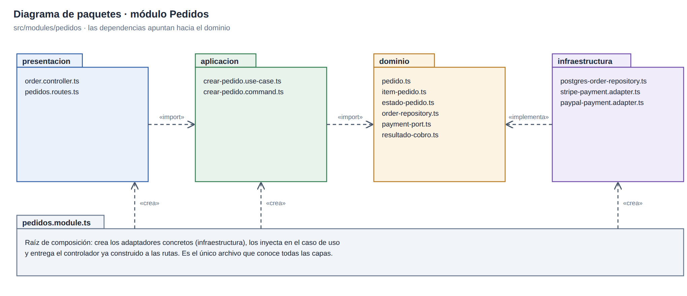
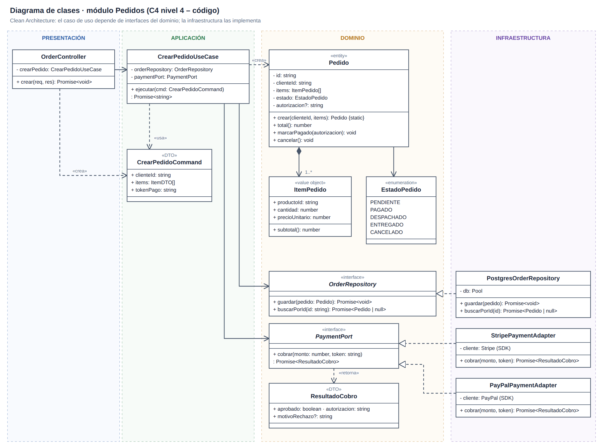
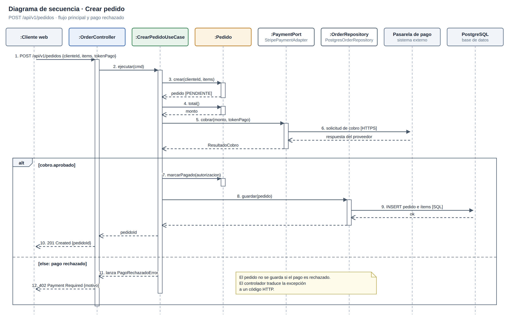

# Diseño interno de módulos

## Capas de Pedidos

[Fuente SVG](../../../img/fuentes-svg/paquetes-modulo-pedidos.svg)

| Capa propuesta | Archivos | Responsabilidad |
|---|---|---|
| Dominio | `pedido.ts`, `item-pedido.ts`, `estado-pedido.ts`, `order-repository.ts`, `payment-port.ts`, `resultado-cobro.ts` | Reglas del pedido y contratos; sin Express ni proveedores. |
| Aplicación | `crear-pedido.use-case.ts`, `crear-pedido.command.ts` | Coordinar creación, cobro y persistencia. |
| Infraestructura | `postgres-order-repository.ts`, `stripe-payment.adapter.ts`, `paypal-payment.adapter.ts` | Implementar contratos con PostgreSQL y pasarelas. |
| Presentación | `order.controller.ts`, `pedidos.routes.ts` | Traducir `POST /api/v1/pedidos` al caso de uso. |
| Composición | `pedidos.module.ts`, `index.ts` | Conectar implementaciones y exponer la API pública. |

## Clases

[Fuente SVG](../../../img/fuentes-svg/clases-modulo-pedidos.svg)

## Crear pedido

[Fuente SVG](../../../img/fuentes-svg/secuencia-crear-pedido.svg)

| Resultado del cobro | Flujo propuesto |
|---|---|
| Aprobado | `Pedido.marcarPagado()` → `OrderRepository.guardar()` → `201 Created`. |
| Rechazado | No guardar el pedido → `402 Payment Required`. |

El backend deberá obtener `clienteId` de la sesión autenticada y los precios del Catálogo. Esta vista concentra `PaymentPort` en Pedidos; [C4 nivel 4](../../04-modelo-c4/Nivel4-DiagramadeCodigo.md) detalla la separación en Pagos mediante `ProcesarPagoUseCase` y la integración con el ERP.

[Patrones](patrones-de-diseño.md) · [SOLID](principios-de-diseño.md)
