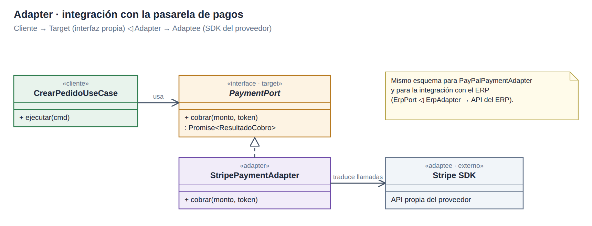
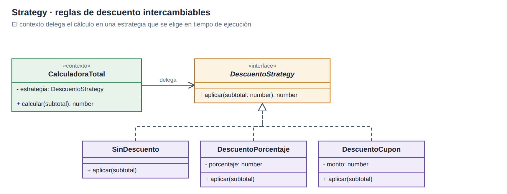
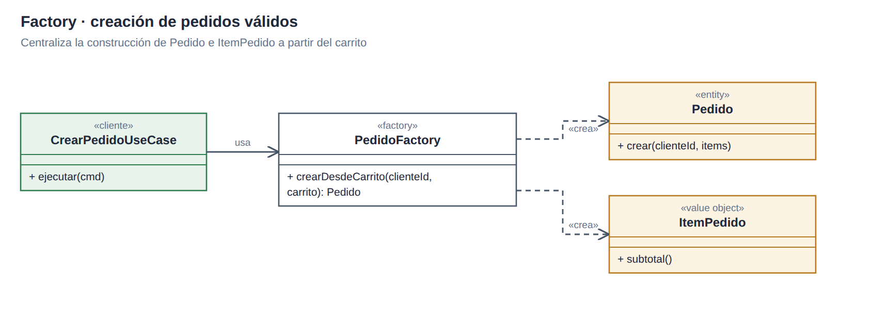
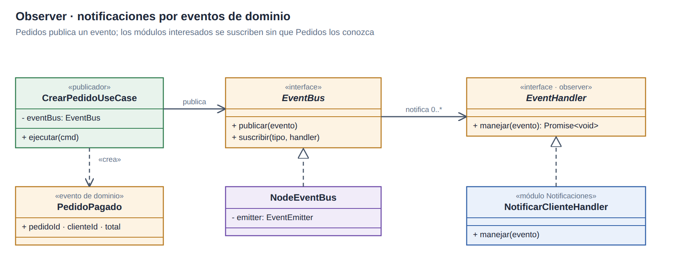
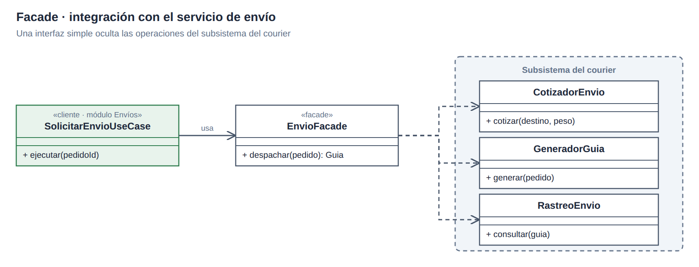

# Patrones de diseño

| Patrón | Colaboración propuesta | Uso |
|---|---|---|
| Adapter | `PaymentPort` → `StripePaymentAdapter` / `PayPalPaymentAdapter`; `ErpPort` → `ErpRestAdapter` | Traducir las API de proveedores. |
| Repository | `OrderRepository` → `PostgresOrderRepository` | Separar reglas de negocio y SQL. |
| Decorator | `cached-product-repository` → repositorio de productos | Consultar Redis antes de PostgreSQL. |
| Strategy | `CalculadoraTotal` → `DescuentoStrategy` | Elegir descuento sin cambiar el cálculo. |
| Factory | `PedidoFactory.crearDesdeCarrito()` | Centralizar la construcción de pedidos válidos. |
| Observer | `PedidoPagado` → `EventBus` → `NotificarClienteHandler` | Avisar sin acoplar Pedidos a Notificaciones. |
| Facade | `SolicitarEnvioUseCase` → `EnvioFacade` | Unificar cotización, guía y rastreo del courier. |

## Adapter

[Fuente SVG](../../../img/fuentes-svg/patron-adapter.svg)

## Strategy

[Fuente SVG](../../../img/fuentes-svg/patron-strategy.svg)

## Factory

[Fuente SVG](../../../img/fuentes-svg/patron-factory.svg)

## Observer

[Fuente SVG](../../../img/fuentes-svg/patron-observer.svg)

## Facade

[Fuente SVG](../../../img/fuentes-svg/patron-facade.svg)

Estos patrones forman parte del diseño del backend; los diagramas no representan integraciones implementadas.

[Diseño de módulos](diseño-interno-de-modulos.md) · [SOLID](principios-de-diseño.md)
