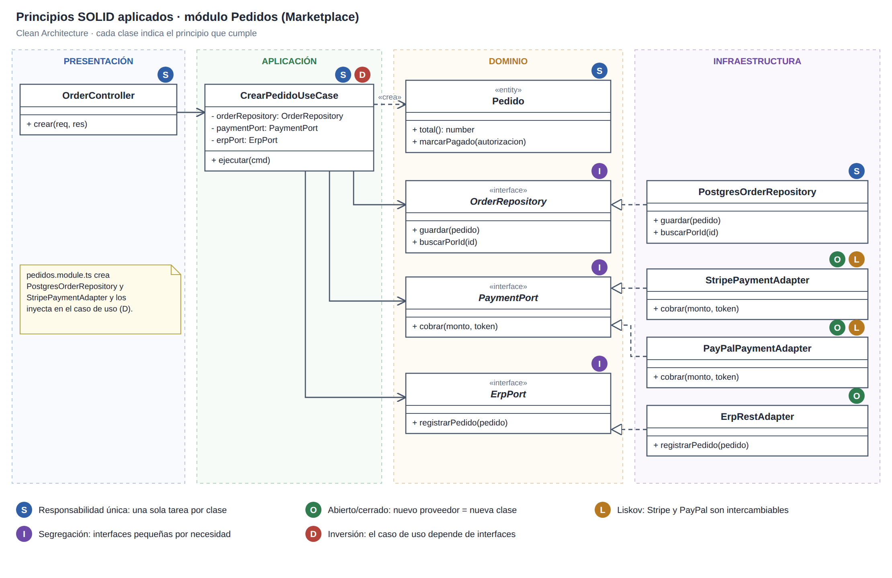
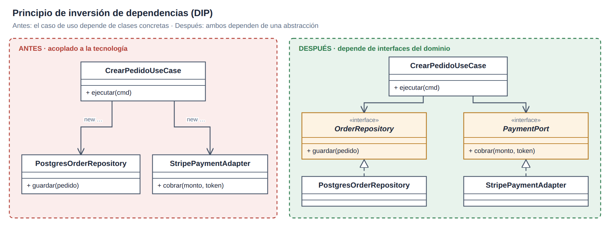

# Principios de diseño · SOLID

| Principio | Aplicación propuesta |
|---|---|
| S · Responsabilidad única | `OrderController` recibe HTTP; `CrearPedidoUseCase` coordina; `Pedido` valida; `PostgresOrderRepository` persiste. |
| O · Abierto/cerrado | Añadir `PayPalPaymentAdapter` o cambiar `ErpRestAdapter` sin modificar las reglas del pedido. |
| L · Sustitución de Liskov | Los adaptadores de pago respetan `PaymentPort` y devuelven `ResultadoCobro`. |
| I · Segregación de interfaces | `OrderRepository` guarda y busca; `PaymentPort` cobra; `ErpPort` registra en el ERP. |
| D · Inversión de dependencias | El caso de uso depende de contratos del dominio; `pedidos.module.ts` inyecta las implementaciones. |

## Inversión de dependencias

[Fuente SVG](../../../img/fuentes-svg/principio-dip.svg)

[Diseño de módulos](diseño-interno-de-modulos.md) · [Patrones](patrones-de-diseño.md)
