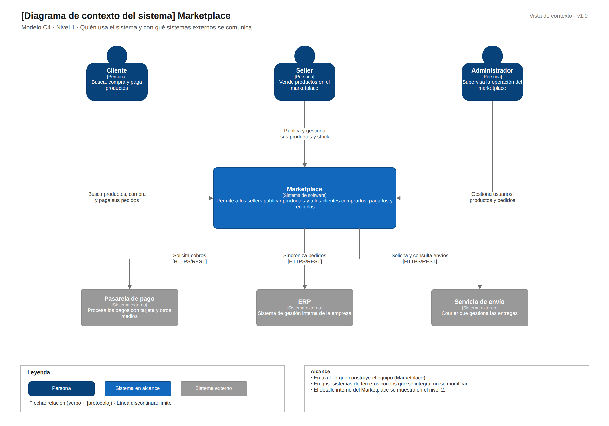

# C4 · Nivel 1: contexto del sistema

[Fuente Draw.io](../../img/fuentes-svg/nivel1-contexto.drawio)

| Participante | Relación con Marketplace |
|---|---|
| Cliente | Busca productos, compra y paga pedidos. |
| Seller | Publica productos y gestiona precios y stock. |
| Administrador | Gestiona usuarios, productos y pedidos. |
| Pasarela de pago | Recibe solicitudes de cobro. |
| ERP | Recibe la sincronización de pedidos. |
| Servicio de envío | Gestiona y permite consultar entregas. |

El Marketplace está dentro del alcance; pasarela, ERP y courier son sistemas externos previstos.

[Siguiente: contenedores](Nivel2-DiagramadeContenedores.md)
