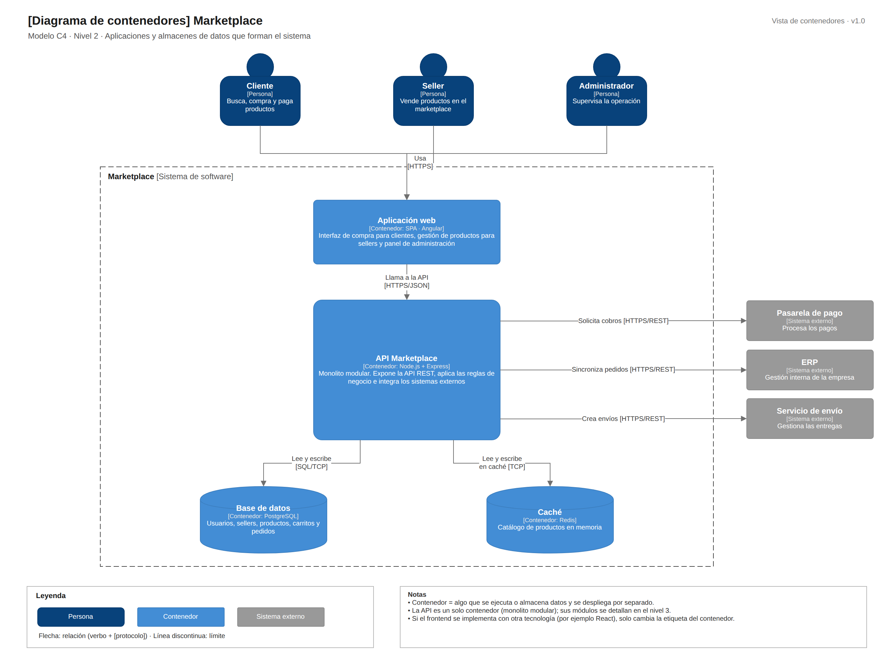

# C4 · Nivel 2: contenedores

[Fuente Draw.io](../../img/fuentes-svg/nivel2-contenedores.drawio)

| Contenedor propuesto | Tecnología | Responsabilidad y comunicación |
|---|---|---|
| Aplicación web | SPA · Angular | Interfaz de usuarios; llama a la API mediante HTTPS/JSON. |
| API Marketplace | Node.js + Express | Monolito modular; procesa compras e integra pasarela, ERP y courier mediante HTTPS/REST. |
| Base de datos | PostgreSQL | Usuarios, sellers, productos, carritos y pedidos; acceso SQL/TCP desde la API. |
| Caché | Redis | Copia temporal del catálogo; acceso TCP desde la API. |

El repositorio contiene el boilerplate Angular demostrativo. La API, PostgreSQL, Redis y las integraciones externas corresponden al diseño propuesto del backend.

[Anterior: contexto](Nivel1-DiagramadeContextodelSistema.md) · [Siguiente: componentes](Nivel3-Diagrama-de-Componentes.md)
