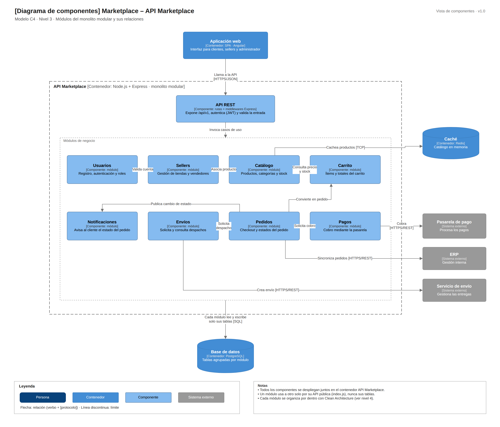

# C4 · Nivel 3: componentes

[Fuente Draw.io](../../img/fuentes-svg/nivel3-componentes.drawio)

| Componente propuesto | Responsabilidad | Colaboración |
|---|---|---|
| API REST | Rutas `/api/v1`, JWT y validación | Invoca los casos de uso. |
| Usuarios | Registro, autenticación y roles | Valida cuentas para Sellers. |
| Sellers | Tiendas y vendedores | Vincula los productos del Catálogo. |
| Catálogo | Productos, categorías, precios y stock | Abastece al Carrito y usa Redis. |
| Carrito | Ítems y totales | Consulta Catálogo; Pedidos lo convierte en compra. |
| Pedidos | Checkout y estados | Solicita Pagos y Envíos, sincroniza ERP y publica cambios. |
| Pagos | Cobro | Integra la pasarela mediante Adapter. |
| Envíos | Solicitud y consulta de despachos | Integra el courier. |
| Notificaciones | Avisos al cliente | Recibe eventos del pedido. |

Los módulos se despliegan juntos, se comunican por sus API públicas y acceden únicamente a sus propias tablas de PostgreSQL. Cada módulo se organiza con Clean Architecture.

[Anterior: contenedores](Nivel2-DiagramadeContenedores.md) · [Siguiente: código](Nivel4-DiagramadeCodigo.md)
