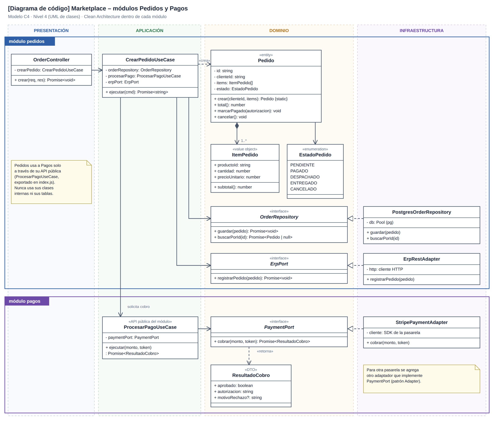
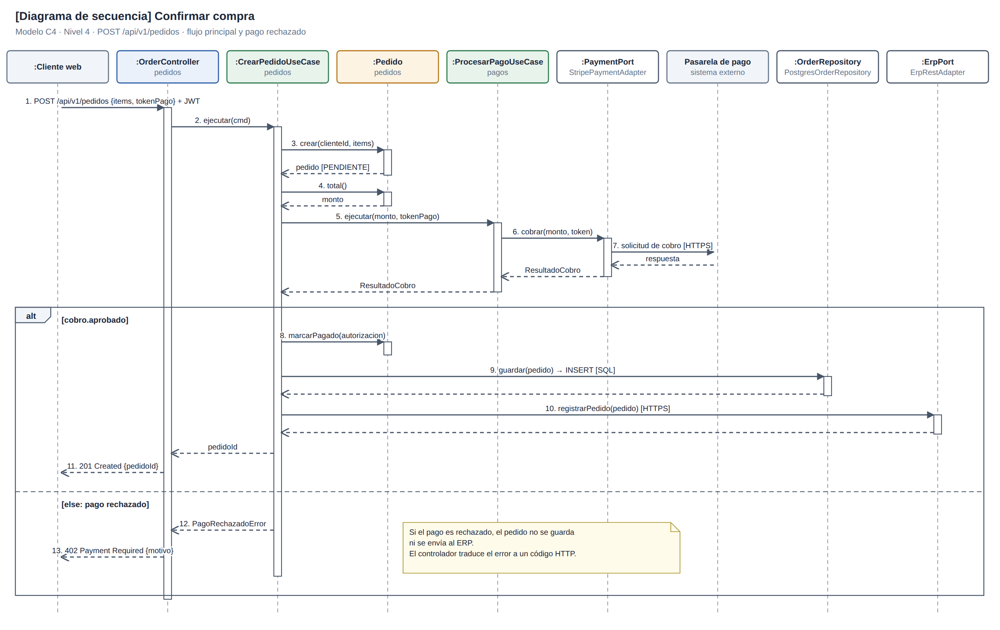

# C4 · Nivel 4: código

## Clases de Pedidos y Pagos

[Fuente SVG](../../img/fuentes-svg/nivel4-clases.svg)

| Módulo / capa propuesta | Elementos | Responsabilidad |
|---|---|---|
| Pedidos / presentación | `OrderController` | Traducir HTTP al caso de uso. |
| Pedidos / aplicación | `CrearPedidoUseCase` | Crear, solicitar cobro, guardar y registrar en ERP. |
| Pedidos / dominio | `Pedido`, `ItemPedido`, `EstadoPedido` | Validar ítems, calcular total y controlar estados. |
| Pedidos / contratos | `OrderRepository`, `ErpPort` | Persistencia y sincronización. |
| Pedidos / infraestructura | `PostgresOrderRepository`, `ErpRestAdapter` | Implementar los contratos con PostgreSQL y ERP. |
| Pagos / aplicación | `ProcesarPagoUseCase` | API pública para solicitar un cobro. |
| Pagos / dominio e infraestructura | `PaymentPort`, `ResultadoCobro`, `StripePaymentAdapter` | Contrato, resultado y traducción hacia la pasarela. |

## Confirmar compra

[Fuente SVG](../../img/fuentes-svg/nivel4-secuencia.svg)

| Pasos | Flujo propuesto |
|---|---|
| 1–4 | `POST /api/v1/pedidos` con JWT → crear `Pedido` PENDIENTE → calcular total. |
| 5–7 | `CrearPedidoUseCase` → `ProcesarPagoUseCase` → `PaymentPort` → pasarela. |
| 8–10 | Cobro aprobado → marcar PAGADO → guardar → registrar mediante `ErpPort`. |
| 11 | Responder `201 Created` con `pedidoId`. |
| 12–13 | Cobro rechazado → `402 Payment Required`; sin persistir ni enviar al ERP. |

Pedidos solicita cobros únicamente mediante la API pública de Pagos. Los diagramas describen el backend propuesto; la recuperación ante fallos posteriores al cobro queda pendiente de implementación.

[Anterior: componentes](Nivel3-Diagrama-de-Componentes.md) · [Diseño interno](../03-diseño-de-software/diseño-interno/diseño-interno-de-modulos.md) · [Patrones](../03-diseño-de-software/diseño-interno/patrones-de-diseño.md) · [SOLID](../03-diseño-de-software/diseño-interno/principios-de-diseño.md)
